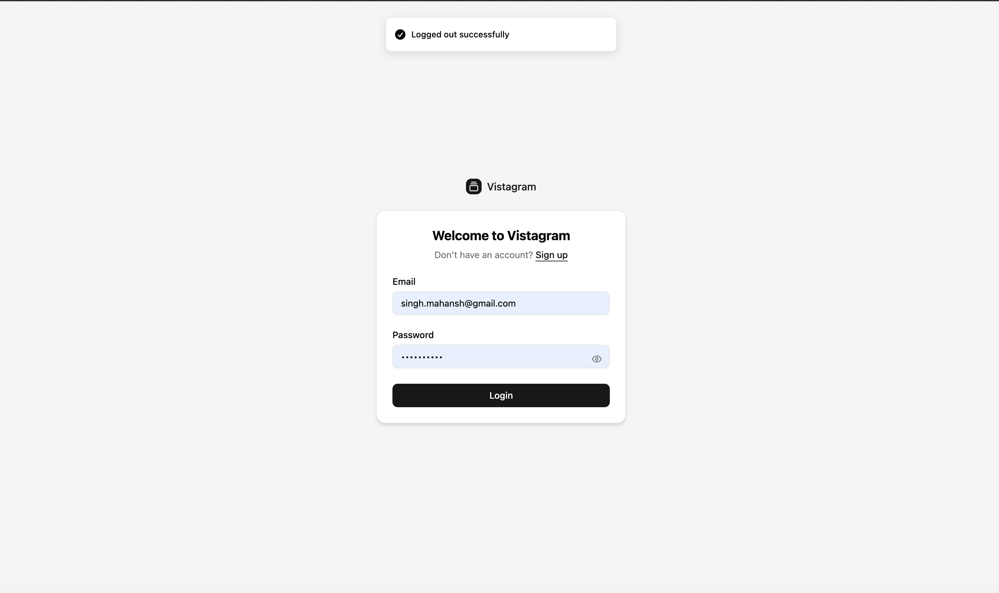
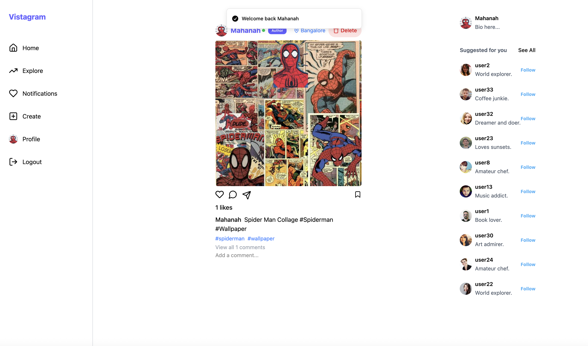
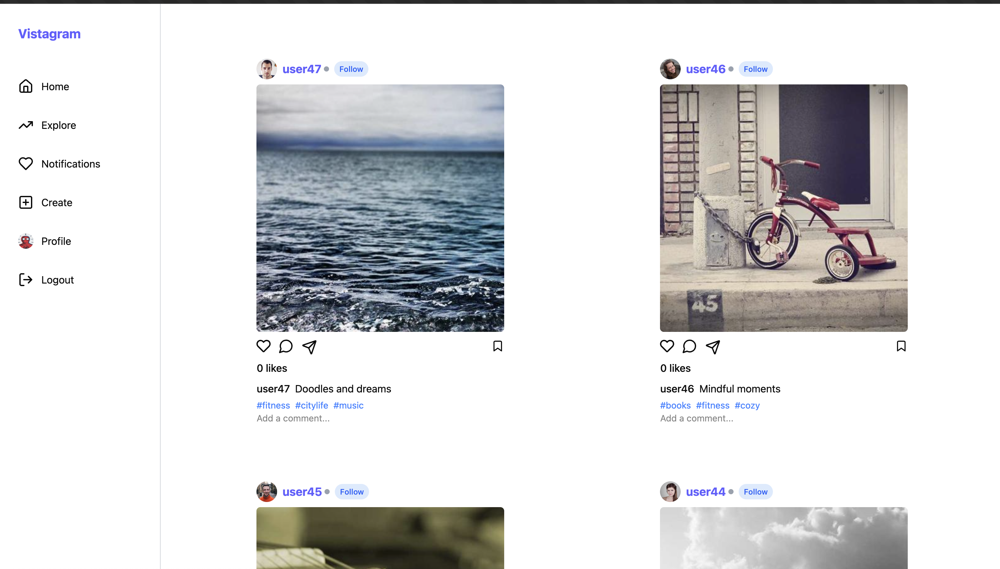
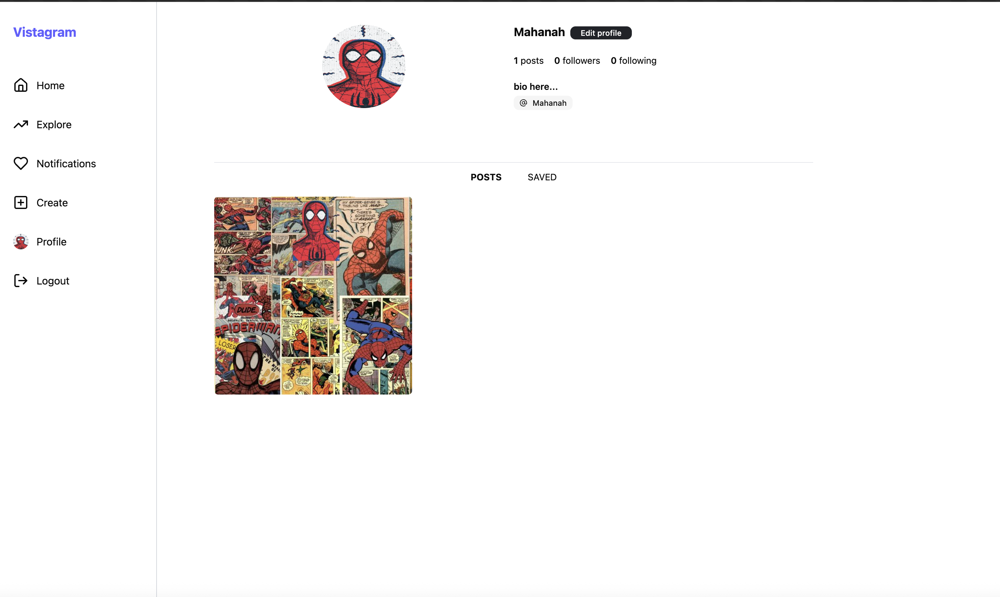
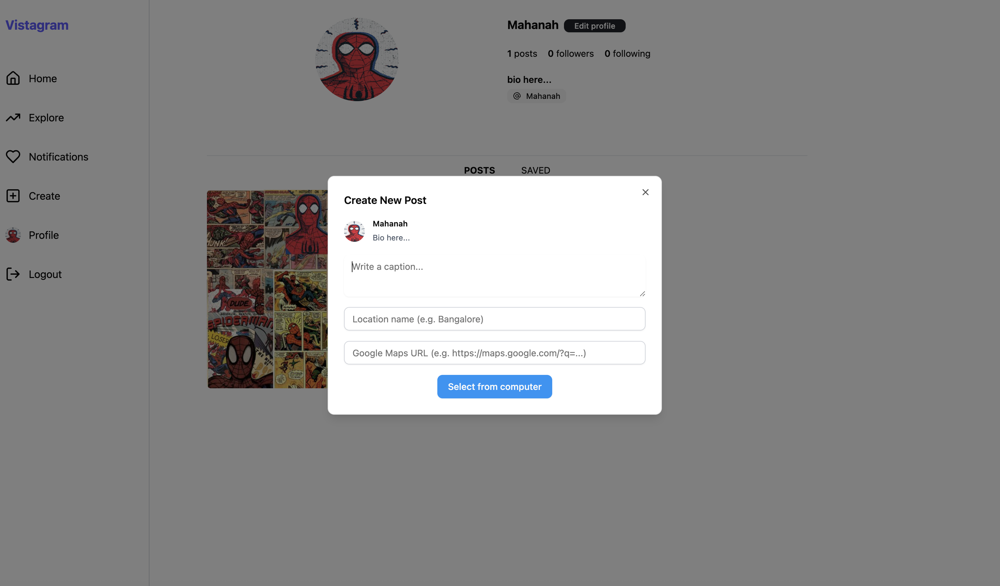

# 📸 Vistagram — Share Moments, Explore Places

[](https://github.com/your-username/vistagram)
[](#-tech-stack)
[](https://opensource.org/licenses/MIT)

---

## ✨ What is Vistagram?

**Vistagram** is a full-stack visual social media platform inspired by Instagram and travel experiences. Users can:
* 🧠 **AI-powered Captioning** using GEMINI AI to auto-generate captions based on image content
- 📷 Upload and share photos with captions, location, and hashtags
- 🔍 Discover posts by hashtag or user
- 💬 Comment, ❤️ Like, 🔖 Bookmark, 🔄 Share posts
- 👥 Follow other users and see their posts
- 🔔 Get real-time notifications via WebSockets
- 🔐 Enjoy full route protection using cookie-based JWT auth

Perfect for communities, travelers, or anyone who loves sharing moments visually.

---

> 🚀 Live Demo:  
> 🖥️ **Frontend**: [headout-vistagram.netlify.app](https://headout-vistagram.netlify.app)  
> 🧠 **Backend**: [vistagram-k3y1.onrender.com](https://vistagram-k3y1.onrender.com)
---


## 🌐 Deployment

### 🔼 Netlify (Frontend)

* CI/CD setup via Netlify
* New build triggered automatically on **push or PR merge** to `development` branch
- **Deployed at** 👉 [headout-vistagram.netlify.app](https://headout-vistagram.netlify.app)
* **Why Netlify?**

  * Simple setup
  * Instant preview deployments
  * Automatic HTTPS & CDN

### 🔁 Render (Backend)

* Auto-deploys from GitHub on changes to `development`
* Server-side environment variables securely managed
- **Deployed at** 👉 [vistagram-k3y1.onrender.com](https://vistagram-k3y1.onrender.com)
* **Why Render?**

  * Easy backend deployment with persistent disk support
  * Simple WebSocket support
  * Built-in domain, health checks

---

## 🧠 Why MongoDB?

We chose **MongoDB** because:

* Schema flexibility allows rapid iteration for user-post-comment relationships
* Embedding references (e.g., likes, comments) is fast for read-heavy social feed
* Cloud-native and scalable, perfect for growing data and user base
* Works well with Mongoose for schema enforcement and validation

---

## 📚 Table of Contents

- [✨ What is Vistagram?](#-what-is-vistagram)
- [🛠 Tech Stack](#-tech-stack)
- [📷 Screenshots](#-screenshots)
- [🚀 Features](#-features)
- [🌳 Folder Structure](#-folder-structure)
- [🔐 Environment Variables](#-environment-variables)
- [💻 Local Setup](#-local-setup)
- [🧪 Dummy Data Setup](#-dummy-data-setup)
- [📡 Socket.IO Realtime](#-socketio-realtime)
- [🔍 Explore Logic](#-explore-logic)
- [🧠 Suggested Users](#-suggested-users)
- [🔐 Protected Routes](#-protected-routes)
- [📬 Post Details](#-post-details)
- [🧭 Profile Page](#-profile-page)
- [🌐 Deployment](#-deployment)
- [🧠 Why MongoDB?](#-why-mongodb)
- [🤖 AI Integration (In Progress)](#-ai-integration-in-progress)
- [✍️ Author](#️-author)
- [📜 License](#-license)

---

## 🛠 Tech Stack

| Layer       | Stack                           |
|------------|----------------------------------|
| Frontend    | React, Vite, TypeScript         |
| Backend     | Node.js, Express.js             |
| Database    | MongoDB (via Mongoose)          |
| Uploads     | Multer + Sharp + Cloudinary     |
| Realtime    | Socket.IO                       |
| State Mgmt  | Zustand                         |
| Styling     | TailwindCSS + Shadcn/UI         |

---

## 📷 Screenshots

### 🔐 Login / Register


### 🏠 Home Feed


### 🔍 Explore


### 👤 Profile


### 🆕 Create


---

## 🚀 Features

- 🌐 JWT Auth via **HTTP-only cookies**
- 📸 Upload image with caption, location, and hashtags (`#`)
- 🔎 Explore page with hashtag/user filtering
- 📩 Real-time notifications via Socket.IO
- 👥 Follow/unfollow users
- 🗃️ Save (bookmark) posts
- 🔗 Shareable post links (publicly viewable)
- 📅 Posts sorted by recency or likes
- 📦 Pagination support for large datasets

---

## 🌳 Folder Structure

```bash
vistagram/
├── client/
│   └── src/
│       ├── assets/          # Static images
│       ├── components/      # Reusable UI
│       ├── configs/         # Constants/config
│       ├── data/            # Dummy/static data
│       ├── lib/             # Utility libraries
│       ├── pages/           # Pages (Home, Explore, Profile)
│       ├── providers/       # Context/Providers
│       ├── service/         # Axios API layer
│       ├── store/           # Zustand stores
│       ├── styles/          # Tailwind/SCSS
│       ├── types/           # TS types
│       └── utils/           # Helpers

├── server/
│   ├── controllers/         # Route logic
│   ├── data/                # Dummy users/posts
│   ├── middlewares/         # Auth, multer, etc.
│   ├── models/              # Mongoose schemas
│   ├── routes/              # Express routes
│   ├── scripts/             # Data migration & cleanup
│   │   ├── dataMigration.js
│   │   └── clearChat.js
│   ├── socket/              # Socket setup
│   ├── utils/               # DB, cloudinary config
│   └── app.js               # Server bootstrap

├── screenshots/             # README visuals
├── README.md
├── netlify.toml             # Netlify config
├── package.json
└── pnpm-lock.yaml
````

---

## 🔐 Environment Variables

### Server `.env`

```env
URL=http://localhost:8080
PORT=8080
MONGO_URI=your-mongodb-uri
SECRET_KEY=your-jwt-secret
CLOUDINARY_CLOUD_NAME=your-cloud-name
CLOUDINARY_API_KEY=your-api-key
CLOUDINARY_API_SECRET=your-api-secret
```

### Client `.env`

```env
VITE_API_URL=http://localhost:8080/api/v1
```

---

## 💻 Local Setup

```bash
# Clone the project
git clone https://github.com/your-username/vistagram.git
cd vistagram
```

### ▶️ Client Setup

```bash
cd client
pnpm install
pnpm run dev
# ➜ http://localhost:5137
```

### ⚙️ Server Setup

```bash
cd server
pnpm install
pnpm run dev
# ➜ http://localhost:8080
```

---

## 🧪 Dummy Data Setup

### 🧬 Migrate Users + Posts

```bash
cd server
node scripts/dataMigration.js
```

### ❌ Delete Chats & Notifications

```bash
cd server
node scripts/clearChat.js
```

---

## 📡 Socket.IO Realtime

WebSocket used for:

* Showing online/offline status
* Sending notifications for:

  * New follower
  * Likes
  * Comments

---

## 🔍 Explore Logic

* Users can search posts using:

  * Hashtag (e.g., `#beach`)
  * Username
  * Both together (e.g., `john #travel`)
* Posts can be sorted by:

  * Newest (default)
  * Most liked
  * Least liked

---

## 🧠 Suggested Users

Logic:

* Users that are followers or following of people you follow
* Fallback to 10 random users (excluding already followed)

---

## 🔐 Protected Routes

* All routes are JWT + cookie protected
* Only unauthenticated users can see login/register
* Public share links don’t require login

---

## 📬 Post Details

Each post has:

* **Header**: Username, online status, location, delete/follow buttons
* **Image**: Click to view details
* **Actions**: Like, comment, share, bookmark

---

## 🧭 Profile Page

Includes:

* All posts by user
* Saved (bookmarked) posts
* Follower/following counts
* Edit profile

---

## 🤖 AI Integration (In Progress)

We're currently exploring:

* 🗺️ **POI Detection**: Recognize locations in images and recommend related Headout experiences (e.g., Eiffel Tower tickets)
* 👓 Will enhance post discoverability and enrich the travel storytelling aspect

---

## ✍️ Author

Built with ❤️ by [Mahansh Aditya](https://github.com/mahanshaditya)

---